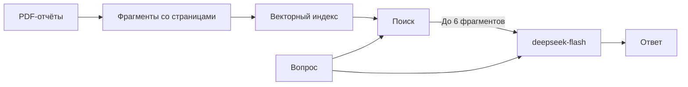

## Как работает RAG



1. **Разбор PDF.** Через PyMuPDF достаю текст и таблицы, сканы распознаю Tesseract. У каждого фрагмента сохраняю `doc_id` и номер страницы
2. **Индекс.** Считаю эмбеддинги фрагментов через Parsers360 и сохраняю векторы в numpy
3. **Поиск.** Считаю эмбеддинг вопроса тем же способом и сравниваю его с векторами фрагментов по косинусной близости. Если в вопросе назван банк, фильтрую фрагменты по метаданным отчёта (`doc_id`). За совпадение года или полугодия +баллы
4. **Ответ.** `deepseek-flash` отвечает за генерацию на основе вопроса и найденных фрагментов

В `rag/` файл `index.py` собирает индекс, `pipeline.py` ищет фрагменты и формирует запрос, `models.py` вызывает API, промпты лежат в `prompts.py`, конфигурация в `config.py`

## Запуск

Python 3.11+, Tesseract с языками `rus` и `eng`

Заполните `LLM_API_KEY` и `EMB_KEY` в `.env` по примеру `.env.example`. Распакуйте [reports.zip](https://media.githubusercontent.com/media/polIINNa/hse_rag_homework/main/data/reports.zip) в `data/reports/`

```bash
pip install -r requirements.txt
python -m rag.index
python -m eval.evaluator_excel data/test.jsonl --output course_test_results.xlsx
```

## Результаты

Средние по 141 вопросу из `data/test.jsonl`. Подробности в `course_test_results.xlsx`.

| Метрика | Среднее |
|---|---:|
| `context_recall` | 0.601891 |
| `context_precision` | 0.143026 |
| `answer_correctness` | 0.709220 |
| `time`, с | 2.010657 |
